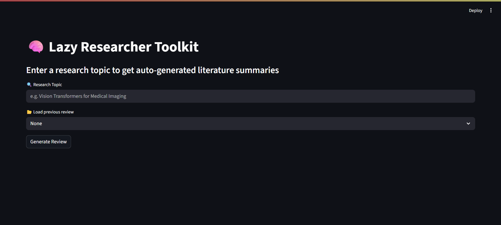
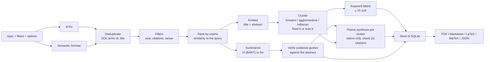

# 🧠 Lazy Researcher Toolkit

[](https://github.com/rushei1/lazy-researcher-toolkit/actions/workflows/ci.yml)


Searches arXiv and Semantic Scholar for a topic, deduplicates and ranks the papers, clusters them by meaning, and summarizes each one either with BART or with an LLM that must back every claim with a quote from the abstract (checked in code). Exports the review as PDF, Markdown, LaTeX or BibTeX. FastAPI backend, Streamlit frontend, SQLite history.

## 📸 Demo



## 🧭 How it works



Details, caching layers and failure behaviour: [docs/architecture.md](docs/architecture.md).

**Grounding is checked against the abstract only.** With the `llm` summarizer each paper gets `problem`, `method`, `results` and `limitations` claims, every claim with a quote. A claim is kept only if its quote occurs in the abstract (whitespace- and case-insensitive); the rest are dropped and counted. A field the abstract does not cover must be "not stated". Full texts are never read, and a verified quote does not prove the claim is a fair reading of it.

## 🚀 Quickstart

### Docker

```bash
docker compose up --build
```

- UI: http://localhost:8501
- API docs: http://localhost:8000/docs

The first review downloads the models (roughly 2 GB for BART-large plus the embedding model) into the `hf_cache` volume; after that they are reused. Reviews and cached LLM replies persist in the `db_data` volume.

### Local (`make`)

Requires Python 3.11+.

```bash
python -m venv .venv && source .venv/bin/activate   # Windows: .venv\Scripts\activate
make install
make run-api     # terminal 1: http://127.0.0.1:8000
make run-ui      # terminal 2: http://localhost:8501
```

Other targets: `make lint`, `make format`, `make test`, `make docker-up`.

### Using the LLM summarizer

The default summarizer is BART (`hf`), which needs no key. To use the LLM backend, point the server at any OpenAI-compatible endpoint; there is deliberately no default model name.

```bash
# OpenAI
export LLM_MODEL=<model name> LLM_API_KEY=<key>
# Local Ollama
export LLM_MODEL=<model name> LLM_BASE_URL=http://localhost:11434/v1
# Anthropic
export LLM_PROVIDER=anthropic LLM_MODEL=<model name> ANTHROPIC_API_KEY=<key>
```

Then pick "llm" in the UI, call `/review?summarizer=llm`, or set `SUMMARIZER_BACKEND=llm`. Without configuration, `summarizer=llm` returns `503`. Replies are cached on disk by content hash, so repeating a review costs nothing.

## 🔌 API

| Method | Path | Description |
|--------|------|-------------|
| GET | `/health` | Liveness check. Does not load any model. |
| GET | `/review?topic=...` | Fetch, summarize and cluster papers. Optional: `num_clusters` (1-8 or `auto`), `cluster_method` (`kmeans`, `agglomerative`, `hdbscan`), `summarizer` (`hf`, `llm`), `max_results` (1-30), `sources` (`arxiv`, `semantic_scholar`), `year_from`, `year_to`, `min_citations`, `venue_contains`. Repeated identical requests are served from the SQLite cache (`cached: true`). |
| GET | `/reviews` | List stored reviews, newest first. |
| GET | `/reviews/{id}` | One stored review. |
| GET | `/reviews/{id}/pdf` | PDF with cluster labels, theme summaries and structured claims. |
| GET | `/reviews/{id}/markdown` | Markdown version of the full review. |
| GET | `/reviews/{id}/latex` | Self-contained `.tex` (theme citations as `\cite`, `thebibliography`). |
| GET | `/reviews/{id}/bibtex` | BibTeX entries with keys like `smith2023vision`. |
| DELETE | `/reviews/{id}` | Delete a review. |

Errors use `{"detail": "..."}`: `422` for an empty topic or invalid parameters, `404` for an unknown review, `502` when every source fails or the LLM fails for every paper, `503` when `summarizer=llm` is requested without an LLM configured. A topic with no matching papers returns `200` with empty `clusters` and a `message`. If one source fails, one paper's summary fails or a theme fails, the response is `200` with what worked and a `warnings` list; such results are saved to history but never served from the cache.

The `clusters` field keeps the v1.0 shape (`{"0": [{"title", "summary", "link"}], ...}`). Everything newer is additive: per paper `structured` (claims), `authors`, `year`, `venue`, `citation_count`, `doi`, `arxiv_id`, `source`; per review `cluster_info` (keyed like `clusters`, with `label`, `theme_summary`, `invalid_citations`) and `warnings`. With `hdbscan`, outliers sit in cluster `"-1"` labelled "Misc / unclustered". In a theme summary `[n]` is the n-th paper (1-based) in that cluster.

## ⚙️ Configuration

Environment variables (or a `.env` file; see `.env.example`):

| Variable | Default | Meaning |
|----------|---------|---------|
| `ARXIV_MAX_RESULTS` | `10` | Papers fetched per review when `max_results` is not given |
| `ARXIV_TIMEOUT_SECONDS` | `30` | Give up on arXiv after this long |
| `DEFAULT_SOURCES` | `arxiv` | Comma list of sources used when the request gives none |
| `S2_API_KEY` | _(unset)_ | Optional Semantic Scholar key. Works without one, but the shared pool is heavily rate limited |
| `DEFAULT_NUM_CLUSTERS` | `3` | Clusters when `num_clusters` is not given (1-8 or `auto`); clamped to the number of papers |
| `CLUSTER_METHOD` | `kmeans` | `kmeans`, `agglomerative` or `hdbscan` |
| `SUMMARIZER_BACKEND` | `hf` | `hf` or `llm`; the `summarizer` query parameter overrides it |
| `SUMMARIZER_MODEL` | `facebook/bart-large-cnn` | Hugging Face summarization model (`hf` backend) |
| `LLM_PROVIDER` | `openai` | `openai` (any OpenAI-compatible server) or `anthropic` |
| `LLM_MODEL` | _(unset)_ | Model name. No default: unset means the `llm` backend is unavailable |
| `LLM_BASE_URL` | _(unset)_ | Server URL, e.g. `http://localhost:11434/v1`. OpenAI's own URL is used if only a key is set |
| `LLM_API_KEY` | _(unset)_ | Key for the OpenAI-compatible endpoint (not needed for e.g. Ollama) |
| `ANTHROPIC_API_KEY` | _(unset)_ | Key when `LLM_PROVIDER=anthropic` |
| `LLM_TIMEOUT_SECONDS` | `60` | Per-request timeout; failed or rate-limited calls are retried with backoff |
| `LLM_CACHE_PATH` | `data/llm_cache.db` | SQLite file caching LLM replies by hash(model, prompt version, abstract) |
| `EMBEDDING_MODEL` | `all-MiniLM-L6-v2` | Sentence-transformers model used for ranking and clustering |
| `DB_PATH` | `data/reviews.db` | SQLite file for history and cache |
| `API_URL` | `http://127.0.0.1:8000` | Backend URL, read by the Streamlit frontend |

## 📁 Project structure

```
app/
  main.py            FastAPI app factory and routes
  config.py          pydantic-settings configuration
  schemas.py         request/response models
  db.py              SQLite history and cache (stdlib sqlite3)
  services/
    fetch.py         PaperSource protocol; arXiv and Semantic Scholar sources
    http.py          GET/POST JSON with retry/backoff/Retry-After and a rate limiter
    retrieve.py      query sources in parallel, dedup, filter, rank
    dedup.py         merge duplicates by DOI / arXiv id / title
    rank.py          cosine ranking of candidates against the query
    llm.py           LLM client protocol (OpenAI-compatible, Anthropic) and content-hash cache
    summarize.py     HF and LLM summarizers, evidence verification
    cluster.py       embedder, kmeans/agglomerative/hdbscan, auto-k, keyword labels
    theme.py         cited theme summaries and citation checking
    export.py        PDF, Markdown, LaTeX and BibTeX export
frontend/app.py      Streamlit UI
tests/               pytest suite (no network, no model downloads)
docs/                architecture and progress notes
Dockerfile, Dockerfile.frontend, docker-compose.yml, Makefile
```

## ✅ Tests

```bash
make test        # or: pytest --cov=app
```

The suite uses a fake embedder, fake summarizers, a scripted fake LLM client and mocked HTTP, injected through FastAPI dependency overrides, so it needs no network, no key and no model weights. Opt-in markers: `--run-slow` loads the real models on three abstracts, `--run-llm` calls a real LLM endpoint configured through the environment (billable), `--run-network` is reserved for live API checks. The frontend smoke tests use Streamlit's `AppTest` and are skipped where Streamlit is not installed (CI installs only the dev requirements). The LaTeX compile test runs only if `pdflatex` is installed.

```bash
make eval         # full evaluation: needs the models, network on the first run;
                  # the LLM arm runs only if LLM_MODEL (+ key or base URL) is set
make eval-quick   # model-free smoke test of the eval code (also run in CI)
```

## 📊 Evaluation

Everything below comes from real runs of the scripts in `eval/` (`make eval`); the full tables, seeds, package versions and a "Not run" list are in [eval/results.md](eval/results.md), and concrete failures are in [eval/results/failure_cases.md](eval/results/failure_cases.md). Arxiv and LLM calls are cached, so a rerun is free and gives the same numbers.

<!-- RESULTS:START -->
| Experiment | Setting | Result |
|---|---|---|
| Clustering (180 papers, proxy labels) | best `agglomerative` (k=true), all-MiniLM-L6-v2 | ARI 0.70, NMI 0.75 |
| Clustering (180 papers, proxy labels) | best `agglomerative` (auto), all-MiniLM-L6-v2 | ARI 0.61, NMI 0.71 |
| Clustering (180 papers, proxy labels) | best `kmeans` (auto), all-MiniLM-L6-v2 | ARI 0.61 ± 0.07, NMI 0.68 ± 0.05 |
| Summarization ROUGE-1/2/L vs abstract (40 papers, weak proxy) | hf:facebook/bart-large-cnn | 0.395 / 0.369 / 0.381 |
| LLM claims whose quote is in the abstract (40 papers) | llm:mistral:latest:summ-v1 | 88.5% of 217 claims |

Full tables, seeds and environment: [eval/results.md](eval/results.md).
<!-- RESULTS:END -->

### What the numbers support

- **Clustering, proxy benchmark** (180 arXiv papers, 6 categories, label = primary category; a proxy for topics, so overlap between categories such as cs.IR and cs.CL puts a ceiling on every score). Agglomerative clustering given the true number of clusters did best with MiniLM (ARI 0.70) and mpnet (0.70), then bge-small (0.67) and SPECTER (0.56). A scientific-text embedding did not help on this proxy.
- **Choosing k automatically is fragile.** Silhouette-based auto-k dropped agglomerative ARI to 0.61 (MiniLM), 0.61 (mpnet), 0.53 (SPECTER) and 0.14 (bge-small, which collapsed to 2 clusters). KMeans results also vary between seeds (std 0.05-0.11 in ARI), so a single-seed comparison would be noisy.
- **HDBSCAN was not usable here.** With the app's own `min_cluster_size` rule it labelled every paper as noise (ARI 0.00 for all four embeddings); fixed sizes of 5 and 10 gave ARI 0.00-0.09 with 47-100% of papers unclustered. KMeans stays the default. BERTopic was competitive for some embeddings (ARI 0.50-0.53 with mpnet and SPECTER) but unstable for others (0.21-0.23, std up to 0.21).
- **LLM grounding** (local `mistral:latest` through Ollama, temperature 0, 40 papers, one paper failed to yield valid JSON after retries): of 217 claims, 192 (88.5%) had their quote verbatim in the abstract and 25 (11.5%) did not and were dropped; 22 of the 39 usable papers had at least one dropped claim. The verifier is doing real work with this model. Every usable paper had `limitations` reported as "not stated". This describes one 7B model on 40 papers, not LLM summarizers in general.
- **ROUGE against the abstract is a weak proxy** and was reported only because it is cheap: LLM claims scored higher (ROUGE-1 0.49 vs 0.39 for BART) but BART's ROUGE-2 (0.37) is almost its ROUGE-1, which indicates it largely copies abstract sentences, so a high score there is not a virtue.
- **NLI did not settle faithfulness.** A small NLI model judged 21% of the LLM's claims and 8% of BART's sentences as entailed by the abstract, and nearly everything else as neutral. It looks conservative for paraphrases, so I draw no conclusion from it.

Not measured: summary quality as judged by people (the blinded rating kit is in `eval/`, but no ratings have been collected), clustering against hand-made topic labels (Part B, awaiting labels), any model other than the ones above.

## ⚠️ Limitations and design decisions

Design decisions:

- **Abstract-only grounding.** Full texts are out of scope, so every quote is checked against the abstract. A verified quote shows textual support, not that the claim is a fair reading of it; theme summaries are checked for valid `[n]` citations, not for factual accuracy.
- **Literal verification.** Quotes must match the abstract after whitespace and case normalization (and be at least 12 characters); there is no fuzzy matching, so a model that tidies punctuation loses that claim rather than getting a pass.
- **Optional LLM, no default model.** The default backend (BART) needs no key. The LLM backend is off until `LLM_MODEL` and credentials are configured, and a review is never silently degraded to a different backend.
- **Everything cacheable is cached** (reviews, LLM replies, eval calls) so repeated work is free and results are reproducible.
- **Cost is not estimated.** Token counts are logged and reported by the eval, but there is no price table, so no dollar figures appear anywhere.

Limitations:

- The BART summarizer truncates title + abstract to 1024 characters and produces generic text, not structured or fact-checked output.
- The evaluation is small: 40 papers for summarization, one local LLM, no human ratings yet, and a proxy benchmark whose sample covers only the first 25 days of 2023. LLM latency in the eval (about 2 minutes per paper) is from a laptop with a 4 GB GPU and is not representative.
- The HDBSCAN `min_cluster_size` rule (10% of the papers, at least 2) is an untuned guess and, per the numbers above, a poor one on this benchmark.
- A model can emit JSON that the schema rejects or that contains invalid escapes; after two retries that paper gets a placeholder and a warning. One of 40 papers failed this way in the evaluation.
- Semantic Scholar is optional and, without an API key, often rate limited (you then get a `warnings` entry and arXiv-only results). arXiv records have no citation counts or venues, so `min_citations` / `venue_contains` drop arXiv-only papers. Filters run after retrieval, so a strict filter can return fewer than `max_results` papers.
- Title-based deduplication is conservative; some cross-source duplicates will survive.
- PDF export uses the built-in Helvetica font, and the LaTeX export targets pdflatex with Latin-1 text: other characters (Greek, CJK) are printed as `?`. The generated `.tex` has been checked structurally in tests but never compiled here, because no LaTeX installation was available.
- One LLM call per paper plus one per cluster: a 30-paper review makes dozens of calls (cached afterwards). There is no background job queue.

## 🗺️ Roadmap

Planned, not done: hand-labelled clustering evaluation and human ratings of summaries (kits are in `eval/`; they need a person), a more forgiving JSON parser for model replies, and a hosted demo (deployment files for Hugging Face Spaces are in the repository and have not been deployed).

## 📄 License

MIT. See [LICENSE](LICENSE). Built by Rusheil Singh Baath.
