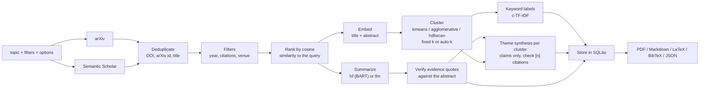

# 🧠 Lazy Researcher Toolkit

[](https://github.com/rushei1/lazy-researcher-toolkit/actions/workflows/ci.yml)


Searches arXiv and Semantic Scholar for a topic, deduplicates and ranks the papers, clusters them by meaning, and summarizes each one either with BART or with an LLM that must back every claim with a quote from the abstract (checked in code). Exports the review as PDF, Markdown, LaTeX or BibTeX. FastAPI backend, Streamlit frontend, SQLite history.

## 📸 Demo


## 🧭 How it works



Details, caching layers and failure behaviour: [docs/architecture.md](docs/architecture.md).

**Grounding is checked against the abstract only.** With the `llm` summarizer each paper gets `problem`, `method`, `results` and `limitations` claims, every claim with a quote. A claim is kept only if its quote occurs in the abstract (whitespace- and case-insensitive); the rest are dropped and counted. A field the abstract does not cover must be "not stated". Full texts are never read, and a verified quote does not prove the claim is a fair reading of it.

## 🚀 Quickstart

### Docker

```bash
docker compose up --build
```

- UI: http://localhost:8501
- API docs: http://localhost:8000/docs

The first review downloads the models (roughly 2 GB for BART-large plus the embedding model) into the `hf_cache` volume; after that they are reused. Reviews and cached LLM replies persist in the `db_data` volume.

### Local (`make`)

Requires Python 3.11+.

```bash
python -m venv .venv && source .venv/bin/activate   # Windows: .venv\Scripts\activate
make install
make run-api     # terminal 1: http://127.0.0.1:8000
make run-ui      # terminal 2: http://localhost:8501
```

Other targets: `make lint`, `make format`, `make test`, `make docker-up`.

### Using the LLM summarizer

The default summarizer is BART (`hf`), which needs no key. To use the LLM backend, point the server at any OpenAI-compatible endpoint; there is deliberately no default model name.

```bash
# OpenAI
export LLM_MODEL=<model name> LLM_API_KEY=<key>
# Local Ollama
export LLM_MODEL=<model name> LLM_BASE_URL=http://localhost:11434/v1
# Anthropic
export LLM_PROVIDER=anthropic LLM_MODEL=<model name> ANTHROPIC_API_KEY=<key>
```

Then pick "llm" in the UI, call `/review?summarizer=llm`, or set `SUMMARIZER_BACKEND=llm`. Without configuration, `summarizer=llm` returns `503`. Replies are cached on disk by content hash, so repeating a review costs nothing.

## 🔌 API

| Method | Path | Description |
|--------|------|-------------|
| GET | `/health` | Liveness check. Does not load any model. |
| GET | `/review?topic=...` | Fetch, summarize and cluster papers. Optional: `num_clusters` (1-8 or `auto`), `cluster_method` (`kmeans`, `agglomerative`, `hdbscan`), `summarizer` (`hf`, `llm`), `max_results` (1-30), `sources` (`arxiv`, `semantic_scholar`), `year_from`, `year_to`, `min_citations`, `venue_contains`. Repeated identical requests are served from the SQLite cache (`cached: true`). |
| GET | `/reviews` | List stored reviews, newest first. |
| GET | `/reviews/{id}` | One stored review. |
| GET | `/reviews/{id}/pdf` | PDF with cluster labels, theme summaries and structured claims. |
| GET | `/reviews/{id}/markdown` | Markdown version of the full review. |
| GET | `/reviews/{id}/latex` | Self-contained `.tex` (theme citations as `\cite`, `thebibliography`). |
| GET | `/reviews/{id}/bibtex` | BibTeX entries with keys like `smith2023vision`. |
| DELETE | `/reviews/{id}` | Delete a review. |

Errors use `{"detail": "..."}`: `422` for an empty topic or invalid parameters, `404` for an unknown review, `502` when every source fails or the LLM fails for every paper, `503` when `summarizer=llm` is requested without an LLM configured. A topic with no matching papers returns `200` with empty `clusters` and a `message`. If one source fails, one paper's summary fails or a theme fails, the response is `200` with what worked and a `warnings` list; such results are saved to history but never served from the cache.

The `clusters` field keeps the v1.0 shape (`{"0": [{"title", "summary", "link"}], ...}`). Everything newer is additive: per paper `structured` (claims), `authors`, `year`, `venue`, `citation_count`, `doi`, `arxiv_id`, `source`; per review `cluster_info` (keyed like `clusters`, with `label`, `theme_summary`, `invalid_citations`) and `warnings`. With `hdbscan`, outliers sit in cluster `"-1"` labelled "Misc / unclustered". In a theme summary `[n]` is the n-th paper (1-based) in that cluster.

## ⚙️ Configuration

Environment variables (or a `.env` file; see `.env.example`):

| Variable | Default | Meaning |
|----------|---------|---------|
| `ARXIV_MAX_RESULTS` | `10` | Papers fetched per review when `max_results` is not given |
| `ARXIV_TIMEOUT_SECONDS` | `30` | Give up on arXiv after this long |
| `DEFAULT_SOURCES` | `arxiv` | Comma list of sources used when the request gives none |
| `S2_API_KEY` | _(unset)_ | Optional Semantic Scholar key. Works without one, but the shared pool is heavily rate limited |
| `DEFAULT_NUM_CLUSTERS` | `3` | Clusters when `num_clusters` is not given (1-8 or `auto`); clamped to the number of papers |
| `CLUSTER_METHOD` | `kmeans` | `kmeans`, `agglomerative` or `hdbscan` |
| `SUMMARIZER_BACKEND` | `hf` | `hf` or `llm`; the `summarizer` query parameter overrides it |
| `SUMMARIZER_MODEL` | `facebook/bart-large-cnn` | Hugging Face summarization model (`hf` backend) |
| `LLM_PROVIDER` | `openai` | `openai` (any OpenAI-compatible server) or `anthropic` |
| `LLM_MODEL` | _(unset)_ | Model name. No default: unset means the `llm` backend is unavailable |
| `LLM_BASE_URL` | _(unset)_ | Server URL, e.g. `http://localhost:11434/v1`. OpenAI's own URL is used if only a key is set |
| `LLM_API_KEY` | _(unset)_ | Key for the OpenAI-compatible endpoint (not needed for e.g. Ollama) |
| `ANTHROPIC_API_KEY` | _(unset)_ | Key when `LLM_PROVIDER=anthropic` |
| `LLM_TIMEOUT_SECONDS` | `60` | Per-request timeout; failed or rate-limited calls are retried with backoff |
| `LLM_CACHE_PATH` | `data/llm_cache.db` | SQLite file caching LLM replies by hash(model, prompt version, abstract) |
| `EMBEDDING_MODEL` | `all-MiniLM-L6-v2` | Sentence-transformers model used for ranking and clustering |
| `DB_PATH` | `data/reviews.db` | SQLite file for history and cache |
| `API_URL` | `http://127.0.0.1:8000` | Backend URL, read by the Streamlit frontend |

## 📁 Project structure

```
app/
  main.py            FastAPI app factory and routes
  config.py          pydantic-settings configuration
  schemas.py         request/response models
  db.py              SQLite history and cache (stdlib sqlite3)
  services/
    fetch.py         PaperSource protocol; arXiv and Semantic Scholar sources
    http.py          GET/POST JSON with retry/backoff/Retry-After and a rate limiter
    retrieve.py      query sources in parallel, dedup, filter, rank
    dedup.py         merge duplicates by DOI / arXiv id / title
    rank.py          cosine ranking of candidates against the query
    llm.py           LLM client protocol (OpenAI-compatible, Anthropic) and content-hash cache
    summarize.py     HF and LLM summarizers, evidence verification
    cluster.py       embedder, kmeans/agglomerative/hdbscan, auto-k, keyword labels
    theme.py         cited theme summaries and citation checking
    export.py        PDF, Markdown, LaTeX and BibTeX export
frontend/app.py      Streamlit UI
tests/               pytest suite (no network, no model downloads)
docs/                architecture and progress notes
Dockerfile, Dockerfile.frontend, docker-compose.yml, Makefile
```

## ✅ Tests

```bash
make test        # or: pytest --cov=app
```

The suite uses a fake embedder, fake summarizers, a scripted fake LLM client and mocked HTTP, injected through FastAPI dependency overrides, so it needs no network, no key and no model weights. Opt-in markers: `--run-slow` loads the real models on three abstracts, `--run-llm` calls a real LLM endpoint configured through the environment (billable), `--run-network` is reserved for live API checks. The frontend smoke tests use Streamlit's `AppTest` and are skipped where Streamlit is not installed (CI installs only the dev requirements). The LaTeX compile test runs only if `pdflatex` is installed.

## ⚠️ Limitations (v2.0 candidate)

- Grounding covers the abstract only. A verified quote shows the claim has textual support, not that the claim is a faithful summary; theme summaries are checked for valid citations, not for factual accuracy.
- The LLM path is covered by tests with a scripted fake client. It has not been run against a live model as part of the test suite, and there is no evaluation yet, so nothing here claims measured summary, grounding or clustering quality. An evaluation harness is the next planned step.
- The BART summarizer still truncates title + abstract to 1024 characters and produces generic text, not structured or fact-checked output.
- Clustering quality is unmeasured. The HDBSCAN `min_cluster_size` (10% of the papers, at least 2) is a guess, and on small result sets it may label many papers as unclustered.
- Semantic Scholar is optional and, without an API key, often rate limited (you then get a `warnings` entry and arXiv-only results). arXiv records have no citation counts or venues, so `min_citations` / `venue_contains` drop arXiv-only papers.
- Filters are applied after retrieval, so a strict filter can return fewer than `max_results` papers.
- Title-based deduplication is conservative; some cross-source duplicates will survive.
- PDF export uses the built-in Helvetica font, and the LaTeX export targets pdflatex with Latin-1 text: characters outside those ranges (Greek, CJK) are printed as `?`. The generated `.tex` has been checked structurally in tests but not compiled in this repository's environment, because no LaTeX installation was available.
- One LLM call per paper plus one per cluster: a 30-paper review makes dozens of calls (cached afterwards). Papers are summarized on a few threads; there is no background job queue.

## 🗺️ Roadmap

Planned, not done:

- Evaluation: a clustering benchmark and a grounding/faithfulness evaluation with reproducible results.
- A hosted demo configuration.

## 📄 License

MIT. See [LICENSE](LICENSE). Built by Rusheil Singh Baath.
