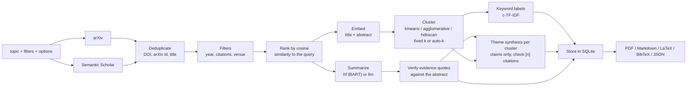

# Architecture

Everything runs inside one `GET /review` request (`app/main.py`); each box is a function in `app/services/`.

## Stages

| Stage | Code | Notes |
|-------|------|-------|
| Sources | `fetch.py`, `http.py` | arXiv and Semantic Scholar behind one `PaperSource` protocol, queried in parallel. Retry with backoff and `Retry-After`, per-source rate limit. One source failing becomes an entry in `warnings`, not an error. |
| Dedup, filters, ranking | `dedup.py`, `retrieve.py`, `rank.py` | Merge by DOI, then arXiv id, then near-identical title with compatible year/authors. Filters run after the merge. Candidates are ranked by cosine similarity between the query and `title + abstract`, and the top `max_results` are kept. |
| Summarize | `summarize.py` | `hf`: BART free text in `overview`. `llm`: structured claims, see below. Chosen with `SUMMARIZER_BACKEND` or the `summarizer` query parameter. |
| Verify | `summarize.py` | Each claim carries a quote. The quote must occur in the abstract (whitespace-normalized, case-insensitive, at least 12 characters). Claims that fail are dropped and counted in `unverified_claims`; they are never shown as grounded. |
| Embed + cluster | `cluster.py` | Embeds `title + abstract`, not the generated summary. `kmeans` and `agglomerative` take a cluster count or choose one by best silhouette in 2..min(8, n-1). `hdbscan` finds its own count and puts outliers in a "Misc / unclustered" group (id `-1`). |
| Labels | `cluster.py` | Top three c-TF-IDF terms per cluster. No LLM involved. |
| Themes | `theme.py` | llm backend only. 3-5 sentences per cluster of two or more papers, written from the members' verified claims. `[n]` is the n-th paper of that cluster. Citations that name no paper in the cluster are stripped and listed in `invalid_citations`; a theme left with no valid citation is dropped with a warning. |
| Store + export | `db.py`, `export.py` | The finished review is saved; the export routes render the stored review. |

## What "grounded" means here

- Grounding is checked against the **abstract only**. The full text is never read, so a claim can be verified yet still be an overstatement of the paper; verification shows the quote exists, not that the claim is a fair reading of it.
- A paper whose abstract does not mention a field (limitations, usually) gets `not_stated` for it, by schema: the model may not leave a field empty or guess.
- Theme summaries are checked for citation validity, not for factual accuracy. They are written only from verified claims, which limits but does not eliminate unsupported statements.

## Caching

| Layer | Key | Stored | Purpose |
|-------|-----|--------|---------|
| Review cache (`reviews` table) | normalized topic + every parameter that affects output (sources, filters, counts, cluster method, summarizer id, embedding model) | the finished review | identical request returns instantly with `cached: true`. Reviews with `warnings` are history, not cache. |
| LLM cache (`llm_cache` table, `LLM_CACHE_PATH`) | sha256(model, prompt version, abstract) for summaries; (model, prompt version, claim list) for themes | the validated model reply | reruns and evaluations need no new LLM calls. Verification re-runs on every read. |

`PROMPT_VERSION` in `summarize.py` is part of both keys: change a prompt or the output schema and bump it.

## Failure behaviour

| Situation | Result |
|-----------|--------|
| Every source fails | `502` |
| Some source fails | `200` with partial results and `warnings` |
| LLM reply is not valid JSON for the schema | up to 2 retries with the validation error fed back, then that paper gets a placeholder summary and a warning |
| LLM fails for every paper | `502` |
| Theme call fails | cluster keeps its label, no theme, warning |
| `summarizer=llm` without LLM configuration | `503` |
