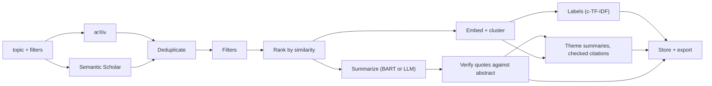

# Grounded literature-review generation: a retrieval, clustering and summarization toolkit with an evaluation of its parts

Rusheil Singh Baath. Draft. Generated from `docs/report_template.md` by `python -m eval.write_report`; all numbers in the Results and Failure analysis sections are copied from `eval/results.md` and `eval/results/failure_cases.md`.

## 1. Motivation

A literature review starts with a pile of papers that has to be sorted into themes and read. Tools that summarize each abstract with a language model are easy to build and hard to trust: a fluent sentence says nothing about whether the abstract supports it. This project builds a small end-to-end pipeline (retrieve, deduplicate, cluster, summarize) and asks two measurable questions: which clustering configuration recovers known groups best, and how often does a language model's claim about an abstract come with a quote that is really in that abstract.

<!-- TODO(rusheil): add 2-3 sentences of personal motivation / the M.Tech angle in your own words. -->

## 2. System overview

Papers are fetched from arXiv and Semantic Scholar in parallel, merged by DOI, arXiv id and title similarity, filtered, and ranked by embedding similarity to the query. Each paper is then summarized by one of two backends and, independently, embedded (title plus abstract) and clustered. Clusters get keyword labels, and with the LLM backend a short theme summary written only from the verified claims of the cluster. The review is stored and exported as PDF, Markdown, LaTeX or BibTeX.

## 3. Methods

**Clustering.** Embeddings are L2-normalised sentence-transformer vectors of `title. abstract`. Compared methods: KMeans and agglomerative (Ward) clustering, each with the true number of classes and with k chosen by silhouette in 2..min(8, n-1); HDBSCAN (the application's rule `min_cluster_size = max(2, 10% of n)` and fixed sizes 5 and 10); and BERTopic on the same embeddings. HDBSCAN noise is treated as one extra cluster when computing ARI, NMI, homogeneity and completeness.

**Grounded summarization.** The LLM is asked for JSON with four fields (problem, method, results, limitations). Each field is either a list of claims, each with a quote copied from the abstract, or the string "not stated". Replies are validated against a schema (two retries with the error fed back). A claim is kept only if its quote occurs in the abstract after whitespace and case normalization and is at least 12 characters long; other claims are dropped and counted. Grounding is against the abstract only.

**Baseline.** BART (`facebook/bart-large-cnn`) on the first 1024 characters of title plus abstract.

## 4. Experimental setup

**Clustering benchmark (proxy).** 180 arXiv papers: the earliest 30 submissions in each of six categories (cs.CL, cs.CV, cs.IR, cs.RO, cs.CR, cs.DB) within a fixed window, labelled with their primary category. The sample falls within 2023-01-01 to 2023-01-25. Four embedding models: all-MiniLM-L6-v2, all-mpnet-base-v2, allenai-specter, BAAI/bge-small-en-v1.5. Randomised methods use five seeds (0-4) and are reported as mean ± population standard deviation.

**Summarization sample.** 40 papers from the same benchmark (round-robin over categories). The LLM arm is a local `mistral:latest` served by Ollama at temperature 0, through the same code path as the application. ROUGE is computed against the abstract with a simple tokenizer and no stemming. Entailment is judged by `cross-encoder/nli-deberta-v3-small`.

**Environment.**

{{include: results.md # Environment}}

## 5. Results

### 5.1 Clustering

{{include: results.md # Clustering (Part A}}

### 5.2 Summarization and grounding

{{include: results.md # Summarization}}

### 5.3 Human evaluation

{{include: results.md # Human evaluation}}

<!-- TODO(rusheil): after collecting your ratings (docs/TODO_USER.md, item 2) and re-running `python -m eval.report` and `python -m eval.write_report`, write 2-3 sentences interpreting them. Do not draw conclusions before then. -->

## 6. Discussion of ablations

The comparisons below are limited to what the tables above show.

- *Embedding model.* With the true k, MiniLM and mpnet gave the highest agglomerative ARI, then bge-small, then SPECTER. On this proxy benchmark the scientific-text model was not better than the general ones.
- *Method and k.* Agglomerative with the true k beat KMeans with the true k for every embedding. Choosing k by silhouette cost accuracy for every embedding and collapsed to two clusters for bge-small.
- *Density-based methods.* HDBSCAN with the application's rule labelled every paper as noise; fixed sizes helped little. BERTopic varied strongly with the embedding and the seed.
- *Summarizer.* The LLM's ROUGE-1 against the abstract was higher than BART's, but BART's ROUGE-2 is close to its ROUGE-1, which suggests near-copying, so ROUGE alone does not rank the two.

<!-- TODO(rusheil): add your interpretation of why these differences occur. The data above does not establish causes (e.g. whether SPECTER underperforms because of the proxy labels or the model), so none is asserted here. -->

## 7. Failure analysis

**Clustering.**

{{include: results/failure_cases.md # Clustering (best configuration}}

**Grounding.**

{{include: results/failure_cases.md # Lowest-grounding}}

<!-- TODO(rusheil): read a few of the listed papers and add a short qualitative note on what kind of mistakes these are (for example, whether the misplaced cs.IR papers are about applications of retrieval to other domains). -->

## 8. Limitations

- The clustering benchmark uses arXiv categories as stand-ins for topics and covers 25 days of one month. The hand-labelled benchmark (Part B) has not been run.
- The grounding result is for one 7B local model on 40 papers, at temperature 0, with one prompt. It says nothing about other models or prompts.
- A verified quote shows that the claim has textual support in the abstract, not that the claim is a faithful reading of it. The NLI check was inconclusive. No human ratings have been collected.
- LLM latency in the evaluation was measured on a laptop with a 4 GB GPU and is not representative.
- Full texts are never read.

## 9. Future work

Collect the human ratings and the hand-labelled clusters; evaluate more models and prompts for grounding, including a more forgiving JSON parser (one of 40 replies failed on an invalid escape); tune HDBSCAN's `min_cluster_size` on a benchmark other than the one used to evaluate it; extend grounding to full text; and deploy the hosted demo.

## Not run in this evaluation

{{include: results.md # Not run}}
